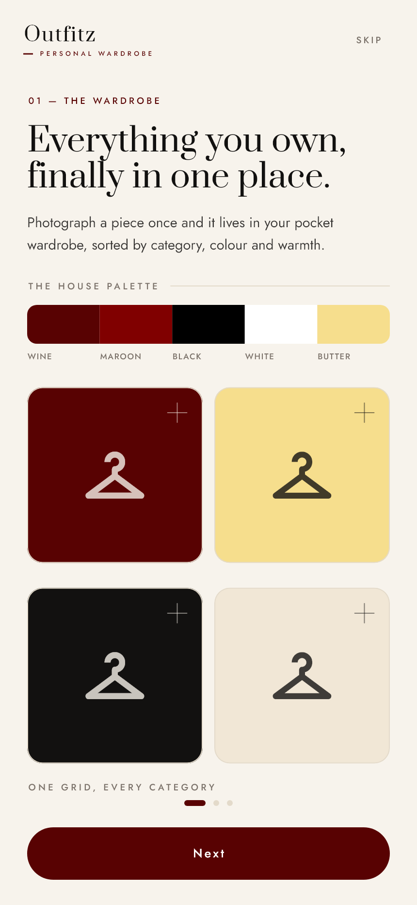
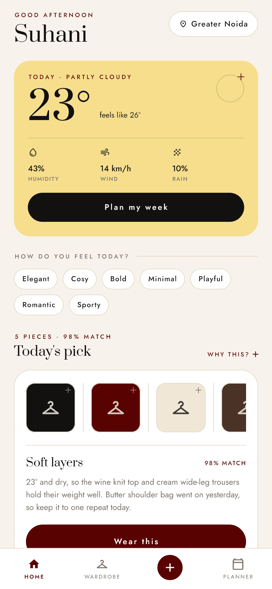
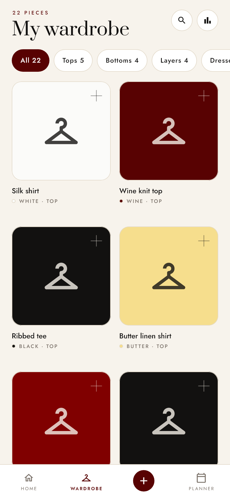
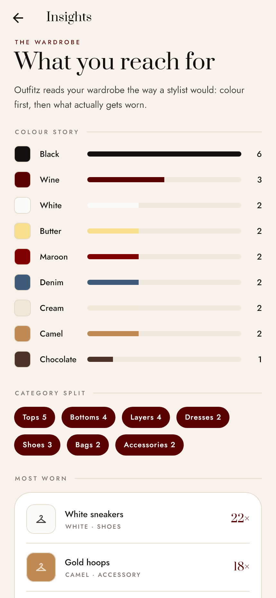
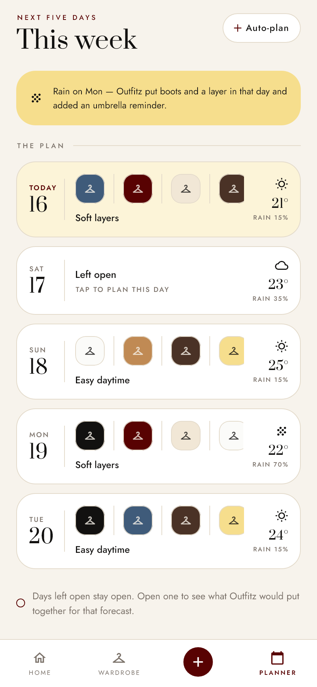

# Outfitz

**Weather-smart outfits from your own wardrobe.**

Photograph a piece of clothing once. Outfitz crops it, reads its colour, proposes
the tags, and then dresses you every morning from what you actually own —
filtered by the forecast, coloured by your mood.

> A DevOps class project, built as a full Flutter + FastAPI + cloud-native
> pipeline. This repository is the **app scaffold**: a complete, working,
> installable UI/UX.

---

## Screens

<p align="center">
  
  
  
</p>
<p align="center">
  
  
</p>

<sub>Rendered from the real app by `test/screenshots.dart`. Regenerate with
`flutter test test/screenshots.dart --update-goldens`.</sub>

---

## Why Outfitz (and not just a ChatGPT wrapper)

Most "AI outfit" ideas are a text prompt in a trench coat — describe your clothes
in words, get words back. Outfitz is different: it **sees** your wardrobe.

- A custom-trained **deep learning model** classifies each photographed garment
  (type, colour, pattern, warmth) instead of asking you to tag everything by hand
  or asking an LLM to guess from a description.
- Suggestions are generated from **real image-based wardrobe data + live weather**,
  not from a language model hallucinating what your clothes might look like.
- A GPT wrapper cannot see your actual closet. Outfitz can.

---

## The brand

Refreshed for 2026 around two reference brand kits: a wine/black/white editorial
palette, and a butter-yellow, hairline-ruled layout.

| | Colour | Hex | Role |
|---|---|---|---|
| 🍷 | Wine | `#580202` | The house colour — actions, active states, brand marks |
| 🟥 | Maroon | `#800000` | Supporting red — gradients, emphasis, mood tags |
| ⬛ | Black | `#000000` | Display type, hairline rules, ink panels |
| ⬜ | White | `#FFFFFF` | Cards, paper |
| 🧈 | Butter yellow | `#F6DE8D` | The warm accent — weather panel, highlights |

**Type:** `Prata` (fine display serif) for headings, `Jost` (light geometric sans)
for everything else. Both are bundled in `assets/fonts/`, so the app has no
network dependency and no runtime font fetching.

**Layout rule:** 60% warm paper + white, 30% wine/maroon ink work, 10% butter
highlight. Nothing outside the palette. Warm paper background `#F7F3EC`, hairline
rules `#E3DACA`, pill controls, generously rounded panels.

Every colour the camera detects is snapped to this palette, which is why detected
colours always look intentional rather than random.

---

## What's in the scaffold today

Everything below is real and working on a phone or in a browser:

| Screen | What it does |
|---|---|
| **Splash & onboarding** | 3-slide intro (wardrobe → scan → mood), shown once, replayable |
| **Home** | Live-mock weather panel, single-select **mood** picker, today's outfit with match score, "why this?" reasoning, your palette strip |
| **Wardrobe** | Category rail with per-category counts, 2-column grid, name/colour search, empty states per category |
| **Add a piece** | Camera **or** gallery → **real crop UI** (drag, resize, rule-of-thirds guide) → auto-detected tags → confirm |
| **Confirm tags** | Simulated analysis pass, then category / 12-swatch colour / warmth range / mood tags / name — all user-editable. Saves a real image to device storage |
| **Item detail** | Colour-field or photo, wear count, freshness, mood tags, edit tags, delete |
| **Outfit detail** | Collage, weather-fit bar, "why it works" copy, `Wear today` (logs wear) and `Save to planner` |
| **Planner** | Five-day plan generated from the forecast, rain warning banner, auto-plan, deliberately-open days |
| **Insights** | Colour story bars, category split, most-worn, "resting" pieces |

### The parts that are genuinely smart

- **`OutfitEngine`** — a transparent rule engine in
  `lib/features/outfits/data/outfit_engine.dart`. Weather decides the *weight* of
  the outfit (layers only appear below 24°C), mood decides its *tone*, a freshness
  rule stops the same tee appearing three days running, and house colours are
  rewarded. `Show another` rotates through the top three candidates.
- **Colour detection** — a weighted, centre-biased colour histogram that runs in a
  background isolate and snaps the result to the brand palette. Deliberately
  conservative, and the user confirms it: exactly the hole the trained model fills.
- **Real image pipeline** — EXIF rotation is resolved once (in an isolate), the
  crop is applied on full-resolution bytes, and the result is normalised to a
  1400px PNG (900px JPEG on web, where local storage is tight).

Wardrobe data persists locally (JSON in `SharedPreferences`, images in the app's
documents directory). Nothing is uploaded, nothing needs a connection.

---

## Run it

Requirements: Flutter 3.4+ (built against 3.44 / Dart 3.12). Android needs the
Android SDK; iOS needs a Mac.

```bash
git clone git@github.com:suhaninagwani/outfitz.git
cd outfitz
flutter pub get
```

### On the web (fastest way to see it)

```bash
flutter run -d chrome
```

The web build intentionally frames the whole app at phone width against an ink
backdrop — it is a phone app, and it says so rather than stretching a bottom-nav
layout across a laptop screen.

For a production bundle:

```bash
flutter build web --release
# output lands in build/web — serve it from any static host
python -m http.server 8080 --directory build/web
```

Two web caveats: the camera option is hidden (browsers only expose a live camera
on mobile), and photos are stored as data URIs in local storage, so they are
smaller and less numerous than on a phone.

### On your Android phone

1. **On the phone:** Settings → About phone → tap *Build number* seven times →
   Developer options → enable **USB debugging**.
2. **Plug it in.** Pull down the notification shade, tap the USB notification,
   and choose **File transfer / MTP**. Accept the *Allow USB debugging?* prompt.
3. **Check Flutter can see it:**

   ```bash
   flutter devices
   ```

   You should see your phone listed, e.g. `SM G991B (mobile) • R58N... • android-arm64`.

4. **Run it straight onto the phone (with hot reload):**

   ```bash
   flutter run -d R58N...        # use the id from `flutter devices`
   ```

   Press `r` to hot reload, `R` to restart, `q` to quit.

**Or build an APK and install it like an app** (no cable needed after this):

```bash
flutter build apk --release
flutter install                # installs onto the connected phone
```

The APK is at `build/app/outputs/flutter-apk/app-release.apk`. You can also copy
that file to the phone and open it (allow "Install unknown apps" for your file
manager).

> The release build is signed with the debug keystore so it installs without
> extra setup. That is fine for personal use; shipping to the Play Store needs a
> real keystore.

Wireless, once set up via `adb tcpip 5555`:

```bash
flutter run -d <phone-ip>:5555
```

### On iOS

Needs a Mac with Xcode. `open ios/Runner.xcworkspace`, set your signing team, then
`flutter run -d <device>`.

---

## Project structure

Clean-architecture-ish, feature-first — the shape the backend will slot into.

```
lib/
├─ main.dart                     # wires storage + repositories into Riverpod
├─ app.dart                      # theme, splash→onboarding→shell gate, nav bar
├─ core/
│  ├─ providers.dart             # every provider in one place
│  ├─ theme/app_theme.dart       # the brand: colours, type scale, component themes
│  ├─ services/
│  │  ├─ crop_service.dart       # isolate: normalise, crop, detect colour
│  │  ├─ image_store.dart        # conditional export → io / web storage
│  │  └─ image_store_io.dart / image_store_web.dart
│  └─ widgets/                   # ornaments, panels, garment tiles, chips
└─ features/
   ├─ onboarding/  splash/       # presentation/
   ├─ weather/     domain + data # mock repository shaped like Open-Meteo
   ├─ wardrobe/    domain (item, category, colour, mood)
   │               data (repository, seed wardrobe)
   │               presentation (wardrobe, add, crop, confirm, item detail, insights)
   ├─ outfits/     domain + data (OutfitEngine) + presentation
   └─ planner/     domain (PlannedDay) + presentation
```

**State:** Riverpod 3 `Notifier`s. **Storage:** `SharedPreferences` + the app
documents directory. **Images:** `image_picker` → `package:image` in a background
isolate → PNG on disk.

---

## Where the backend comes in

Nothing above needs a server. Everything below is the proposal to discuss.

**Stack:** FastAPI (Python 3.11) · PostgreSQL · Redis · S3-compatible object
storage · Docker → AWS (ECS Fargate or App Runner) → Terraform · GitHub Actions.

| Endpoint | Purpose |
|---|---|
| `POST /v1/items` | Multipart upload → stores the image → returns the classifier's tags |
| `GET/PATCH/DELETE /v1/items` | Wardrobe CRUD + manual tag corrections |
| `POST /v1/outfits` | Wardrobe + weather + mood → ranked outfits with reasons |
| `GET /v1/weather` | Server-side weather proxy (keeps the API key off the client, one cache for everyone) |
| `POST /v1/items/{id}/feedback` | "Wore this / not this" — the ranking signal |

**The model.** A fine-tuned image classifier (EfficientNet-B0 or MobileNetV3
backbone) predicting category, colour family, pattern and warmth band. Fine-tuned
on a garment dataset (DeepFashion / Fashionpedia) plus your own labelled
corrections. Exported to **ONNX for the server** and **TFLite for on-device**, so
classification still works offline — the server is for syncing and ranking, not
for basic tagging.

**Cost efficiency, concretely:** Open-Meteo for weather (free, no key), CPU-only
inference on a small instance (garment classification is not heavy), Redis caching
of weather and outfit ranks, S3 lifecycle rules for thumbnails, and scale-to-zero
if we go App Runner or Lambda behind API Gateway.

**What we need to decide:**

1. **On-device vs server inference.** On-device is free, private and offline, but
   harder to update. A hybrid (on-device default, server for corrections) is my
   recommendation.
2. **Where the wardrobe lives.** Local-first with optional sync (recommended), or
   account-first.
3. **Weather source.** Open-Meteo (free) vs OpenWeather (key, free tier).
4. **Auth.** Anonymous device IDs first, real accounts later.
5. **How much of the ranking is learned.** Rules are explainable and cheap; a
   learned re-ranker on wear feedback is the eventual goal.

---

## Roadmap

- [x] Brand system, type scale, component library
- [x] Onboarding, home, wardrobe, item detail, outfit detail, planner, insights
- [x] Camera / gallery capture with a real crop step
- [x] Auto-detected colour + user-confirmed tags, persisted locally
- [x] Weather-aware, mood-aware outfit generation (rule engine)
- [ ] FastAPI backend + Postgres + object storage
- [ ] Trained garment classifier (server ONNX + on-device TFLite)
- [ ] Account + wardrobe sync
- [ ] Learned outfit ranking from wear feedback
- [ ] Docker → Terraform → AWS, GitHub Actions CI/CD
- [ ] Deploy to production

---

## Credits

Built by [Suhani Nagwani](https://github.com/suhaninagwani).
Fonts: [Prata](https://fonts.google.com/specimen/Prata) and
[Jost](https://fonts.google.com/specimen/Jost), both under the SIL Open Font
License — see `assets/fonts/OFL-*.txt`.
